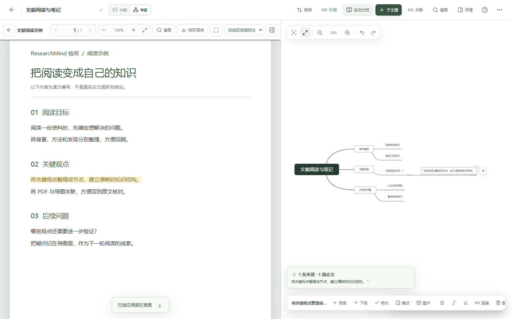
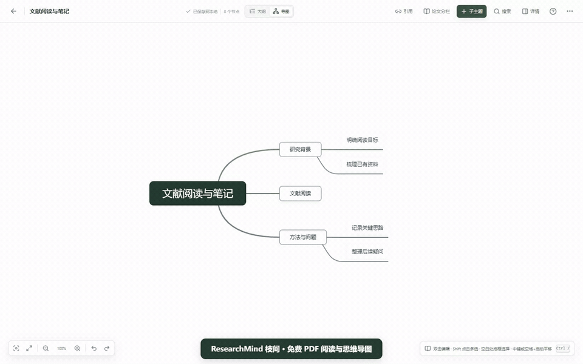

# ResearchMind 枝间 · 免费 PDF 阅读与思维导图

把文献、批注和阅读笔记放进同一张思维导图。无需注册，支持网页版与 Windows 桌面版，资料保存在当前设备。

**[立即在线体验](https://fly-01-hub.github.io/Mind-map-download/)** · **[下载 Windows 安装包](https://github.com/fly-01-hub/Mind-map-download/releases/latest)** · [反馈问题](https://github.com/fly-01-hub/Mind-map-download/issues)



## 30 秒看看怎样使用



[播放或下载 MP4 演示](https://raw.githubusercontent.com/fly-01-hub/Mind-map-download/main/assets/demo.mp4) · [查看纯导图界面](assets/mindmap.png) · [分享介绍文案](promotion/share-copy.txt)

演示录制于实际应用，使用专门编写的虚构 PDF 和示例导图，不含个人资料。视频中的步骤字幕与文件拖动提示用于说明操作。

## 适合哪些事情

| 你的需求 | 可以怎样使用 |
| --- | --- |
| 阅读文献时反复切换窗口 | 把 PDF 拖到节点，双击文献节点，在同一页阅读原文和查看导图 |
| 想把关键句整理成结构 | 在分栏阅读中选中文字并高亮，生成带来源关联的文献子节点 |
| 整理学习笔记或写作提纲 | 在大纲中快速输入，在导图中查看结构，两种视图共用内容 |
| 希望资料保存在自己设备 | 内容保存在当前浏览器或桌面程序，支持完整备份迁移 |

首次打开为空白知识库；网页版首次在线加载缓存后支持离线使用。不同设备、浏览器和桌面版之间不自动同步，请定期导出完整备份。

欢迎试用并通过 Issues 提出建议。如果它对你有帮助，可以 Star 收藏或分享给有同样需求的人。

本项目免费分发，源码保持私有。本仓库提供使用说明、演示素材、Windows 安装包入口，以及 gh-pages 分支中的网页运行资源。

## 在线使用（免费）

[打开网页版](https://fly-01-hub.github.io/Mind-map-download/)。无需安装或启动本机服务器，支持浏览器中的 PWA 安装；首次在线加载后可离线使用已缓存功能。资料保存在各自浏览器，浏览器清理数据可能导致资料丢失，请定期导出完整备份。网页版与桌面版本的资料不会自动同步。

## 下载安装

当前版本：**1.7.7**，Windows 64 位（x64）。

- [直接下载 ResearchMind-Setup-1.7.7-x64.exe](https://github.com/fly-01-hub/Mind-map-download/releases/download/v1.7.7/ResearchMind-Setup-1.7.7-x64.exe)
- [打开最新版本下载页](https://github.com/fly-01-hub/Mind-map-download/releases/latest)

1. 点击上面的 EXE 下载链接。也可以打开下载页，展开 **Assets**，点击 `ResearchMind-Setup-1.7.7-x64.exe`。
2. 如果已使用旧版，先在旧版中创建完整备份，再关闭旧版。
3. 双击下载的 EXE，按照安装向导选择安装位置并完成安装。
4. 从桌面或 Windows 开始菜单打开 **ResearchMind 枝间**。它是本地桌面程序，不需要运行网页服务，也不需要保持浏览器打开。

**安全提示：**当前安装包未使用可信商业代码签名，Windows 安全保护可能提示或阻止安装。遇到拦截请停止，记录提示并反馈；不要关闭防护、添加排除项或绕过拦截。校验值只能核对文件是否一致，不能代替签名或安全检测。

GitHub 自动附带的 `Source code (zip)` / `Source code (tar.gz)` 以及 `Code → Download ZIP`，仅包含本下载仓库的说明文档，不是程序源码，也不是安装包。请下载 `.exe`。

安装包大小：137,166,593 字节。SHA-256：

```text
DDCD18E7387B6DE765047302F916CC985A1D4A0F742EDCC3F1A66FF4F594138F
```

如需核对，在下载文件所在文件夹打开 PowerShell，执行：

```powershell
Get-FileHash -Algorithm SHA256 -LiteralPath '.\ResearchMind-Setup-1.7.7-x64.exe'
```

## 五分钟上手

### 1. 新建第一份导图

首次安装并使用全新的用户数据空间时，知识库为空白，没有预置导图、论文、附件或历史记录。点击右上角 **“新建思维导图”**，编辑标题和主题，即可开始记录。

如果这台电脑以前用过本软件，升级后仍显示你自己的资料是正常的；“空白发行”不会清除已有用户数据。

### 2. 用大纲输入，用导图查看结构

在文档中切换大纲和思维导图，两种视图共用同一份节点树，不必分别维护。也可使用 `Ctrl + Alt + Shift + M` 切换。

在大纲中编辑主题时：

- `Enter`：拆分当前主题并新建同级主题。
- `Tab`：缩进为上一主题的下级；`Shift + Tab`：提升一级。
- `Shift + Enter`：进入或退出主题描述区。
- `Ctrl + Z`：撤销；`Ctrl + Y`：重做。

在思维导图中双击普通节点编辑文字；PDF 文献节点单击选中、双击打开分栏。选中节点后显示加减按钮，按 `Tab` 添加下级，按 `Enter` 提交编辑并添加同级。右键节点可查看编辑和排序操作。中键拖动，或按住空格再用鼠标左键拖动，可平移画布。

选中文字可设置局部格式和颜色；`Ctrl + /` 打开操作指南与快捷键。输入法正在选词时，`Enter` 优先确认候选文字。

### 3. 整理、关联和阅读资料

- 在知识库首页使用搜索、文件夹、收藏和回收站整理文档。回收站中的文档可恢复，永久删除不可撤销。
- 在主题中输入 `[[文档名称]]`，双击高亮名称可打开或新建关联文档。
- 点击首页 **“论文与批注”** 管理论文。将 PDF 拖到导图节点，可关联论文并阅读、批注；图片和其他文件也可作为节点资料保存在本地。
- 根据文档中的导入、导出入口交换 Markdown、OPML 等文件；这些交换格式不保证所有字段无损，不能替代完整备份。

## 保存、完整备份与恢复

编辑内容自动保存到当前用户的本地数据空间，**不会自动上传 GitHub，也不会自动跨设备同步**。自动保存不等于备份；清理应用数据、重装系统或设备故障都可能导致资料丢失。

### 创建完整备份

1. 返回知识库首页，点击右上角 **“备份与恢复”**。
2. 点击 **“创建完整备份”**。
3. 将生成的 `.researchmind` 文件保存到自己选择的文件夹，等待“备份已保存”的提示。
4. 建议再保存一份到移动硬盘或自行管理的备份位置。

完整备份包含导图、文件夹、回收站、历史版本、附件、PDF、批注、阅读进度及关联关系；不包含界面偏好或尚在内存中的撤销栈。备份未加密，请妥善保管，不要上传本公开仓库或作为公开问题的附件。

### 从备份恢复或迁移

1. 如果目标应用里已有内容，先创建它的完整备份。
2. 点击 **“备份与恢复 → 从备份恢复”**，选择 `.researchmind` 文件。
3. 阅读确认提示：**恢复会整体替换当前应用的数据库，不是合并**。
4. 确认后等待恢复完成和页面重载，再检查文档、论文及附件。

网页/PWA、不同浏览器和 Windows 桌面版使用各自的数据空间，不会自动搬运旧资料。迁移时应在原来使用的版本中导出完整备份，再在目标版本中恢复；不要把 Windows 配置文件夹当成 `.researchmind` 文件导入。

## 更新与常见问题

- **如何更新？** 本版本没有自动升级服务。先备份、关闭旧版，再从本仓库下载新版 EXE 并按向导覆盖安装；正常升级保留原用户数据。不要为了升级删除用户配置或数据库。
- **为什么第一次打开没有文档？** 这是预期行为；点击“新建思维导图”或恢复你自己的备份。
- **为什么浏览器中的文档没有出现在桌面版？** 两者数据空间独立，需通过完整备份迁移。
- **找不到备份文件？** 备份位置由保存对话框中自己的选择决定。记下保存目录和文件名；软件不会把备份放到 GitHub。
- **安装被阻止或打不开？** 停止操作，保留 Windows 版本、软件版本及完整提示文字；反馈前遮挡私人信息。不要禁用安全保护。
- **PDF 批注是否写回原 PDF？** 不会；批注保存在应用的本地数据库和完整备份中。扫描 PDF 没有文字层时不支持 OCR 搜索。

本软件以个人使用为主，没有在线协作、账号云同步或全局知识图谱。大型知识库和超大 PDF 会占用较多内存，请定期备份。测试不能保证所有设备和历史资料都零缺陷。

## 发行与隐私边界

公开仓库的 main 分支提供说明文档，gh-pages 分支提供网页构建资源；均不包含原始开发工程或私有源码历史；Release 的人工上传附件只有 EXE，不包含开发者的导图、PDF、数据库、备份或真实资料截图。新用户不会得到他人的知识库。

“不在仓库发布源码”不意味着程序无法被逆向分析。EXE 必须包含运行所需的程序资源，可能被提取；本仓库不承诺防逆向或绝对源码保密。后续公开更新仅上传经核验的安装包、说明及网页构建资源，不上传私有源码仓库的分支、标签或历史。

反馈可使用本仓库的 [Issues](https://github.com/fly-01-hub/Mind-map-download/issues)。请只提供脱敏后的问题描述，不提交完整个人备份、论文或数据库。
